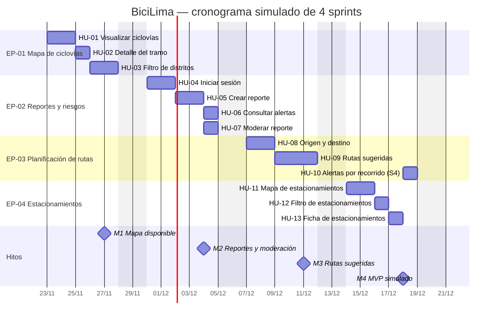

# BiciLima — Planificación académica para Jira (Preguntas 1 y 2)

> **Documento de propuesta para registro manual en Jira.** Basado únicamente en las dos preguntas y rúbricas compartidas del examen «Ciclistas en Lima». No contiene evidencias de tareas realmente ejecutadas. Las fechas, métricas y movimientos son **simulación académica**. No usar CSV.

## Supuestos para la simulación

- Nombre propuesto: **BiciLima**. El enunciado no impone nombre.
- Actores: ciclista visitante, ciclista registrado y moderador.
- Las ciclovías, rutas e instalaciones se muestran únicamente con datos del catálogo de prueba que se carguen; no se presume que existan datos oficiales completos ni seguridad verificada.
- «Ruta sugerida» expresa una alternativa informativa según los tramos disponibles y reportes validados, **no garantiza seguridad**.
- Los cuatro sprints ficticios tienen cinco días hábiles, del **23/11/2026 al 18/12/2026**. No equivalen a cuatro sprints realmente ejecutados durante el examen.
- Prioridades Jira orientativas: Must→High; Should→Medium; Could→Low. Guardar también el valor MoSCoW en la descripción o etiqueta si Jira no ofrece un campo propio.
- Story Points: Fibonacci 1, 2, 3, 5, 8. Estimaciones relativas propuestas, no resultados de una reunión Planning Poker celebrada.

## Pregunta 1: Épicas

| ID de planificación | Resumen/nombre de épica | Descripción | Objetivo de negocio | Sprint |
|---|---|---|---|---|
| EP-01 | Mapa de ciclovías | Mapa interactivo de tramos, características, estado conocido y filtros distritales | Facilitar acceso a información sobre infraestructura ciclista | 1 |
| EP-02 | Reportes y alertas de riesgo | Autenticación, registro de incidentes, consulta y moderación de reportes ciudadanos | Mejorar disponibilidad de información y participación ciudadana | 2 |
| EP-03 | Planificación de rutas ciclistas | Indicar origen/destino, consultar opciones de recorrido y advertencias por tramo | Facilitar desplazamientos teniendo en cuenta conectividad y reportes disponibles | 3; HU-10 pasa a 4 en la simulación |
| EP-04 | Estacionamientos para bicicletas | Consulta de estacionamientos, filtros por zona y condiciones conocidas | Ayudar a identificar posibles lugares de estacionamiento | 4 |

## Pregunta 1: Historias para copiar en Jira

### EP-01 — Mapa de ciclovías

**HU-01 — Visualizar ciclovías en el mapa**
- **Historia:** Como ciclista visitante, quiero visualizar las ciclovías disponibles en un mapa para identificar por dónde puedo desplazarme.
- **SP:** 5. **MoSCoW:** Must. **Prioridad Jira:** High. **Sprint inicial:** 1. **Dependencias:** ninguna.
- **Estimación:** 5 por integración del mapa, geodatos y estados de carga.
- **CA1:** Dado que existen ciclovías publicadas, cuando ingreso al mapa, entonces veo sus trazados y ubicaciones.
- **CA2:** Dado que el catálogo no tiene ciclovías para mostrar, cuando abro el mapa, entonces el sistema presenta un estado vacío claro sin inventar resultados.

**HU-02 — Consultar detalle de un tramo**
- **Historia:** Como ciclista visitante, quiero consultar información de un tramo de ciclovía para conocer sus características y estado reportado.
- **SP:** 3. **MoSCoW:** Must. **Prioridad Jira:** High. **Sprint inicial:** 1. **Dependencias:** HU-01.
- **Estimación:** 3 por consulta y presentación de información del tramo existente.
- **CA1:** Dado que selecciono un tramo con datos disponibles, cuando abro su ficha, entonces veo distrito, descripción y estado reportado.
- **CA2:** Dado que no hay datos verificados sobre el estado, cuando consulto la ficha, entonces se muestra «Sin información verificada» en lugar de declararlo seguro.

**HU-03 — Filtrar ciclovías por distrito**
- **Historia:** Como ciclista visitante, quiero filtrar las ciclovías por distrito para encontrar infraestructura en una zona de mi interés.
- **SP:** 5. **MoSCoW:** Should. **Prioridad Jira:** Medium. **Sprint inicial:** 1. **Dependencias:** HU-01.
- **Estimación:** 5 por filtros geográficos, actualización del mapa y comprobación de resultados.
- **CA1:** Dado que hay tramos de varios distritos, cuando selecciono un distrito, entonces veo solo los tramos asociados a ese filtro.
- **CA2:** Dado que el distrito elegido no tiene registros, cuando aplico el filtro, entonces aparece un mensaje sin resultados.

### EP-02 — Reportes y alertas de riesgo

**HU-04 — Iniciar sesión**
- **Historia:** Como ciclista registrado, quiero iniciar sesión para enviar reportes asociados a mi cuenta.
- **SP:** 5. **MoSCoW:** Must. **Prioridad Jira:** High. **Sprint inicial:** 2. **Dependencias:** ninguna.
- **Estimación:** 5 por integración de identidad, control de sesiones y errores.
- **CA1:** Dado que dispongo de credenciales válidas, cuando inicio sesión, entonces accedo a las acciones permitidas a mi cuenta.
- **CA2:** Dado que las credenciales son incorrectas, cuando intento iniciar sesión, entonces el acceso se deniega y aparece un mensaje adecuado.

**HU-05 — Registrar un reporte de riesgo**
- **Historia:** Como ciclista registrado, quiero reportar un obstáculo o condición de riesgo para informar a otros usuarios sobre el problema.
- **SP:** 5. **MoSCoW:** Must. **Prioridad Jira:** High. **Sprint inicial:** 2. **Dependencias:** HU-04.
- **Estimación:** 5 por formulario, ubicación, validaciones y almacenamiento.
- **CA1:** Dado que tengo sesión válida y completo ubicación, tipo y descripción, cuando envío el reporte, entonces queda almacenado como pendiente de revisión.
- **CA2:** Dado que no he iniciado sesión, cuando intento publicar un reporte, entonces se rechaza la operación sin crear registros.

**HU-06 — Consultar alertas de riesgo**
- **Historia:** Como ciclista visitante, quiero consultar alertas de riesgo validadas en el mapa para tomar precauciones durante mi recorrido.
- **SP:** 3. **MoSCoW:** Must. **Prioridad Jira:** High. **Sprint inicial:** 2. **Dependencias:** HU-05 y mecanismo de validación.
- **Estimación:** 3 por consulta y visualización de registros con estado validado.
- **CA1:** Dado que existen reportes validados, cuando consulto el mapa, entonces veo su ubicación aproximada, tipo y fecha del aviso.
- **CA2:** Dado que un reporte está pendiente o rechazado, cuando consulto alertas públicas, entonces ese reporte no se muestra como validado.

**HU-07 — Moderar reportes de riesgo**
- **Historia:** Como moderador, quiero aprobar o rechazar reportes ciudadanos para evitar publicar información sin revisión.
- **SP:** 3. **MoSCoW:** Should. **Prioridad Jira:** Medium. **Sprint inicial:** 2. **Dependencias:** HU-05.
- **Estimación:** 3 por cambio de estado controlado y comprobación de permisos.
- **CA1:** Dado que soy moderador y hay un reporte pendiente, cuando lo reviso y apruebo, entonces queda disponible para consulta pública.
- **CA2:** Dado que soy ciclista sin rol de moderador, cuando intento aprobar un reporte, entonces el servidor o la base de datos deniega el cambio.

### EP-03 — Planificación de rutas ciclistas

**HU-08 — Indicar origen y destino**
- **Historia:** Como ciclista visitante, quiero indicar mi origen y destino para consultar posibles recorridos en bicicleta.
- **SP:** 5. **MoSCoW:** Must. **Prioridad Jira:** High. **Sprint inicial:** 3. **Dependencias:** HU-01.
- **Estimación:** 5 por captura de puntos, validaciones y manejo de ubicaciones inexistentes.
- **CA1:** Dado que selecciono un origen y un destino válidos, cuando solicito un recorrido, entonces el sistema procesa ambos puntos.
- **CA2:** Dado que falta uno de los puntos, cuando intento buscar, entonces se solicita completar la selección.

**HU-09 — Consultar recorridos sugeridos**
- **Historia:** Como ciclista visitante, quiero visualizar recorridos sugeridos entre dos puntos para comparar opciones de desplazamiento.
- **SP:** 8. **MoSCoW:** Must. **Prioridad Jira:** High. **Sprint inicial:** 3. **Dependencias:** HU-08 y datos de tramos disponibles.
- **Estimación:** 8 por lógica de rutas, conectividad y visualización; mayor incertidumbre técnica.
- **CA1:** Dado que hay recorridos disponibles en el catálogo de prueba, cuando solicito una ruta, entonces veo una o más alternativas identificadas como sugerencias, no como rutas garantizadas seguras.
- **CA2:** Dado que no hay recorrido disponible, cuando consulto la ruta, entonces el sistema informa esa limitación sin fabricar una ruta.

**HU-10 — Ver advertencias de un recorrido**
- **Historia:** Como ciclista visitante, quiero visualizar las alertas asociadas a un recorrido para considerar riesgos reportados al elegir mi ruta.
- **SP:** 3. **MoSCoW:** Should. **Prioridad Jira:** Medium. **Sprint inicial:** 3; **traslado simulado:** 4. **Dependencias:** HU-06 y HU-09.
- **Estimación:** 3 por cruce de alertas validadas con los tramos representados.
- **CA1:** Dado que una ruta atraviesa tramos con alertas validadas, cuando consulto sus detalles, entonces se muestran las alertas asociadas.
- **CA2:** Dado que una ruta no tiene alertas registradas, cuando la consulto, entonces se informa «Sin alertas registradas», sin prometer ausencia de riesgo.

### EP-04 — Estacionamientos para bicicletas

**HU-11 — Visualizar estacionamientos**
- **Historia:** Como ciclista visitante, quiero ubicar estacionamientos para bicicletas en un mapa para planificar dónde dejar mi bicicleta.
- **SP:** 5. **MoSCoW:** Should. **Prioridad Jira:** Medium. **Sprint inicial:** 4. **Dependencias:** HU-01 o componente de mapa reutilizable.
- **Estimación:** 5 por ubicación y marcadores de estacionamientos.
- **CA1:** Dado que existen estacionamientos registrados, cuando abro el módulo, entonces los visualizo en el mapa.
- **CA2:** Dado que no hay registros en la zona, cuando consulto el mapa, entonces veo un mensaje de ausencia de datos.

**HU-12 — Filtrar estacionamientos por distrito**
- **Historia:** Como ciclista visitante, quiero filtrar estacionamientos por distrito para encontrar opciones cerca de mi destino.
- **SP:** 3. **MoSCoW:** Could. **Prioridad Jira:** Low. **Sprint inicial:** 4. **Dependencias:** HU-11.
- **Estimación:** 3 por un filtro sobre datos existentes.
- **CA1:** Dado que hay estacionamientos de distintos distritos, cuando elijo uno, entonces aparecen solo los correspondientes.
- **CA2:** Dado que no existen coincidencias, cuando aplico el filtro, entonces veo un estado vacío claro.

**HU-13 — Consultar condiciones de estacionamiento**
- **Historia:** Como ciclista visitante, quiero ver la información disponible de un estacionamiento para evaluar si me sirve antes de llegar.
- **SP:** 5. **MoSCoW:** Should. **Prioridad Jira:** Medium. **Sprint inicial:** 4. **Dependencias:** HU-11.
- **Estimación:** 5 por ficha, condiciones y tratamiento de datos no verificados.
- **CA1:** Dado que selecciono un estacionamiento publicado, cuando consulto su ficha, entonces veo ubicación y condiciones conocidas, por ejemplo horario o tipo de acceso cuando estén disponibles.
- **CA2:** Dado que falta información sobre vigilancia o disponibilidad, cuando abro la ficha, entonces esos campos se muestran como «Por confirmar», sin garantizar seguridad.

### Resumen para el backlog

| HU | Épica | SP | MoSCoW | Prioridad Jira | Sprint inicial |
|---|---|---:|---|---|---:|
| HU-01 | EP-01 | 5 | Must | High | 1 |
| HU-02 | EP-01 | 3 | Must | High | 1 |
| HU-03 | EP-01 | 5 | Should | Medium | 1 |
| HU-04 | EP-02 | 5 | Must | High | 2 |
| HU-05 | EP-02 | 5 | Must | High | 2 |
| HU-06 | EP-02 | 3 | Must | High | 2 |
| HU-07 | EP-02 | 3 | Should | Medium | 2 |
| HU-08 | EP-03 | 5 | Must | High | 3 |
| HU-09 | EP-03 | 8 | Must | High | 3 |
| HU-10 | EP-03 | 3 | Should | Medium | 3; se traslada al 4 en simulación |
| HU-11 | EP-04 | 5 | Should | Medium | 4 |
| HU-12 | EP-04 | 3 | Could | Low | 4 |
| HU-13 | EP-04 | 5 | Should | Medium | 4 |
| **Total único** | **4 épicas / 13 HU** | **58** | | | |

**Ingreso manual en Jira:** Crear `Epic` y pegar nombre/objetivo/descripción; crear cada `Story` con resumen, descripción e indicadores `Dado/Cuando/Entonces`; asignar `Parent` a la épica realmente creada; elegir prioridad Jira; registrar los puntos; añadir etiqueta/nota MoSCoW; asociar sprint. Los IDs EP/HU son referencias académicas: usar las claves reales que Jira genere. Capturar listados y detalles, verificar visibilidad al docente.

## Pregunta 2: Cuatro sprints

**Fechas de simulación**, todos con **5 días hábiles**:

| Sprint | Fechas | Sprint Goal | HU comprometidas | SP comprometidos | SP terminados (simulación) |
|---|---|---|---|---:|---:|
| 1 | 23–27 nov 2026 | Consultar y filtrar la infraestructura ciclista en mapa | HU-01(5), HU-02(3), HU-03(5) | 13 | 13 |
| 2 | 30 nov–4 dic 2026 | Registrar, consultar y moderar reportes de riesgos | HU-04(5), HU-05(5), HU-06(3), HU-07(3) | 16 | 16 |
| 3 | 7–11 dic 2026 | Obtener recorridos sugeridos entre origen y destino | HU-08(5), HU-09(8), HU-10(3) | 16 | 13 |
| 4 | 14–18 dic 2026 | Consultar estacionamientos y completar las alertas de rutas | HU-10(3) trasladada, HU-11(5), HU-12(3), HU-13(5) | 16 | 16 |

**Total de historias únicas:** 13, total **58 SP**. **Total de SP comprometidos a lo largo de las iteraciones:** 61 (HU-10 de 3 SP comprometida dos veces tras quedar pendiente en sprint 3). **Velocidad simulada:** 13, 16, 13, 16 SP. **Media:** 14,5 SP/sprint. No inventar resultados como progreso real de Jira.

### Burndown: valores por día (SP pendientes)

Cada sprint: `D0` es el inicio; `D1`–`D5` son los cinco días hábiles. La línea ideal es un descenso lineal entre el compromiso inicial y cero.

| Sprint | Serie | D0 | D1 | D2 | D3 | D4 | D5 |
|---|---|---:|---:|---:|---:|---:|---:|
| 1 | Ideal | 13 | 10,4 | 7,8 | 5,2 | 2,6 | 0 |
| 1 | Simulado | 13 | 13 | 8 | 5 | 5 | 0 |
| 2 | Ideal | 16 | 12,8 | 9,6 | 6,4 | 3,2 | 0 |
| 2 | Simulado | 16 | 16 | 11 | 6 | 3 | 0 |
| 3 | Ideal | 16 | 12,8 | 9,6 | 6,4 | 3,2 | 0 |
| 3 | Simulado | 16 | 16 | 11 | 11 | 3 | 3 |
| 4 | Ideal | 16 | 12,8 | 9,6 | 6,4 | 3,2 | 0 |
| 4 | Simulado | 16 | 16 | 11 | 8 | 3 | 0 |

**Cálculo:** Velocidad de cada sprint = SP iniciales – SP no terminados al cierre. Sprint 1 = 13; Sprint 2 = 16; Sprint 3 = 13; Sprint 4 = 16. La planificación del Sprint 4 se ajusta para incorporar la HU-10 pendiente del Sprint 3. **La gráfica nativa de Jira solo reflejará el historial real de un sprint iniciado; los valores de arriba son un escenario académico.**

### Gantt — cuatro épicas, HU, fechas, dependencias e hitos

**Dependencias clave:** HU-02/HU-03→HU-01; HU-05→HU-04; HU-06/HU-07→HU-05; HU-08→HU-01; HU-09→HU-08; HU-10→HU-06 y HU-09; HU-12/HU-13→HU-11.

### Kanban: columnas y WIP

| Columna | WIP | Entrada | Salida |
|---|---:|---|---|
| To Do | Sin límite | HU priorizada y asignada al sprint | Criterios entendidos y comienzo de desarrollo |
| In Progress | Máximo 2 HU | Desarrollo iniciado | Código y validaciones listos para revisión |
| In Review | Máximo 2 HU | Pruebas/revisión pendientes | Aceptación verificada, sin bloqueadores |
| Done | Sin límite | Cumple DoD | Completada dentro del sprint |

**DoD propuesta:** criterios de aceptación validados, control de acceso verificado si aplica, cambios guardados en repo, pruebas disponibles ejecutadas, sin secretos expuestos y evidencia registrada. No suponer pipeline o despliegue aprobado antes de ejecutarlo.

**Snapshots académicos para mostrar el flujo** (no son capturas reales):

| Sprint | Momento | To Do | In Progress | In Review | Done |
|---|---|---|---|---|---|
| 1 | Día 3 | — | HU-03 | — | HU-01, HU-02 |
| 1 | Cierre | — | — | — | HU-01, HU-02, HU-03 |
| 2 | Día 3 | HU-07 | HU-06 | — | HU-04, HU-05 |
| 2 | Cierre | — | — | — | HU-04, HU-05, HU-06, HU-07 |
| 3 | Día 4 | — | HU-10 | — | HU-08, HU-09 |
| 3 | Cierre | — | — | — | HU-08, HU-09; HU-10 pendiente se planifica en sprint 4 |
| 4 | Día 3 | HU-10 | HU-13 | — | HU-11, HU-12 |
| 4 | Cierre | — | — | — | HU-10, HU-11, HU-12, HU-13 |

**Evidencias reales a generar manualmente:** capturas del backlog, cuatro épicas, detalle de HU y Story Points, cuatro sprints con Sprint Goal y contenido, burndown por sprint (si está generado por Jira), informe/diagrama Gantt con fechas e hitos, tablero de cuatro columnas con WIP y snapshots reales de movimiento, enlace Jira compartido con el docente.

### Rúbrica de control

| Criterio | Puntos | Estado inicial |
|---|---:|---|
| P1 Épicas | 1,5 | Texto preparado; falta registro y captura en Jira |
| P1 Historias vinculadas y Gherkin | 1,5 | Texto preparado; falta registro y verificación en Jira |
| P1 Estimación y prioridad | 1,0 | Propuesta preparada; falta asignación en Jira |
| P1 Evidencia accesible | 1,0 | Pendiente |
| P2 4 sprints / goals / backlog / SP | 1,5 | Simulación preparada; falta Jira |
| P2 Burndown ideal vs. real / velocidad | 1,5 | Valores simulados, no ejecución real |
| P2 Gantt | 1,0 | Diagrama propuesto; pendiente validación y evidencia |
| P2 Kanban / límites WIP / flujo | 1,0 | Reglas y snapshots simulados; faltan capturas reales |
| **TOTAL** | **10** | **No equivale a nota obtenida** |

> **Regla de examen:** compartir los enlaces reales de Jira, GitHub y Vercel con el docente, y enviar el código final en ZIP; no inventar enlaces ni capturas. Poder explicar oralmente estimaciones, decisiones, historias, gráficos y permisos.
